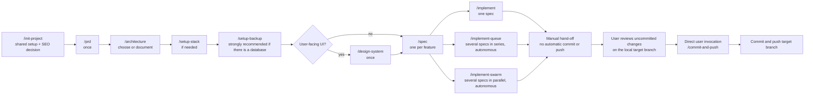

<em>Designed and maintained by <a href="https://jeanrakotoarison.com" target="_blank" rel="noopener noreferrer">Jean Rakotoarison</a></em>

This agentic starter helps you build complete apps, or take over existing ones, from specs, not prompts, with Claude Code or OpenCode and on any stack.

In more technical terms, it is a harness-agnostic, stack-agnostic Spec-Driven Development (SDD) workflow layer that turns Claude Code or OpenCode into a pipeline: framing (once per project, new or existing), then, for each feature, spec → implementation (dev + reviews) → handoff.

<br>

> **To start a new project, clone this repo. To add the starter workflow to an existing project, copy the starter files into it. Then run:**
>
> ```
> /init-project
> ```
>
> To bring a project that already uses the starter up to date later, run `/update-workflow`.

# agentic-starter

A stack-agnostic starter for building projects with Claude Code, OpenCode, or another local coding agent, following a **Spec-Driven Development (SDD)** workflow. It ships the agentic tooling layer only - no application code - so it works with whatever backend, frontend, and hosting you choose.



## Summary

A complete overview of the starter for readers who want everything in one place. Each part is detailed in the pages listed under Documentation.

### What it is

- **A tooling layer, not an application.** No app code: persistent project context (`.context/`), slash commands, specialized subagents, hooks, and conventions that make a coding agent work spec first.
- **Spec-Driven Development.** Nothing consequent is built without a written spec, and every spec is verified against its acceptance criteria.
- **Tool-agnostic.** The canonical logic lives once in `.context/commands/`; thin wrappers mirror it for Claude Code (`.claude/`) and OpenCode (`.opencode/`).
- **Local and user-controlled Git.** No pull requests. Verified work lands uncommitted on your local target branch; only your direct `/commit-and-push` commits and pushes.
- **Guided by two layers of rules.** An Absolute Directive (think before coding, simplicity first, surgical changes, goal-directed execution) and stack conventions, enforced by automatic reviews.

### The lifecycle

| Stage | When | What happens |
| --- | --- | --- |
| 1. Install | Once per project | Clone the starter for a new project, or copy its files into an existing one, then run `/init-project` |
| 2. Framing | Once per project | `/init-project` → `/prd` → `/architecture` → `/setup-stack` → `/setup-backup` (strongly recommended for projects with a database) → `/design-system` (UI projects). `/spec` stays blocked until it is complete |
| 3. Features | Every feature | `/spec` → `/implement` (or `/implement-queue` / `/implement-swarm` for several specs). Implementation, spec verification, then the reviews, looped up to 5 times until clean |
| 4. Quick fixes | Small changes (≤ 3 files, no new feature) | Write the code directly; the agent then runs `/review-changes`, `/review-performance`, `/review-seo` (only on SEO-flagged work), and `/review-security` |
| 5. Handoff | After every verified change | The changes sit uncommitted on the target branch; you review with VS Code or `git diff HEAD`, then invoke `/commit-and-push` |
| 6. Inspect | Any time | `/status` shows the framing state and every spec's pipeline stage, read-only |
| 7. Keep current | When the starter evolves | `/update-workflow` brings the project's workflow files up to date and migrates legacy numeric specs |

## Documentation

| Page | What it covers |
| --- | --- |
| [Getting started](docs/getting-started.md) | Starting a project, and updating an initialized one with `/update-workflow` |
| [Every command](docs/commands.md) | All slash commands, grouped by purpose |
| [AI development workflow](docs/workflow.md) | Framing, features and quick fixes, the per-spec cycle, autonomous batches |
| [The review pipeline](docs/reviews.md) | The five reviews, their subagents and what each one fixes |
| [Specs and isolation](docs/specs-and-isolation.md) | Spec IDs, worktrees, per-spec files, batches |
| [Guardrails](docs/guardrails.md) | Hooks and gates that run automatically |
| [Test-driven development](docs/tdd.md) | The red-green-refactor loop and how tests are tracked |
| [Design tools](docs/design-tools.md) | Design briefs and references handed to the local coding agent |
| [What lives in `.context/`](docs/context-folder.md) | Project context files, supported stacks, quality rules |
| [What's included](docs/whats-included.md) | Every folder and file the starter ships |
| [Security rule updates](docs/security-rules.md) | The committed OWASP snapshot and its weekly refresh |

---

<p align="center"><strong>Authored by <a href="https://jeanrakotoarison.com" target="_blank" rel="noopener noreferrer">Jean Rakotoarison</a></strong></p>
