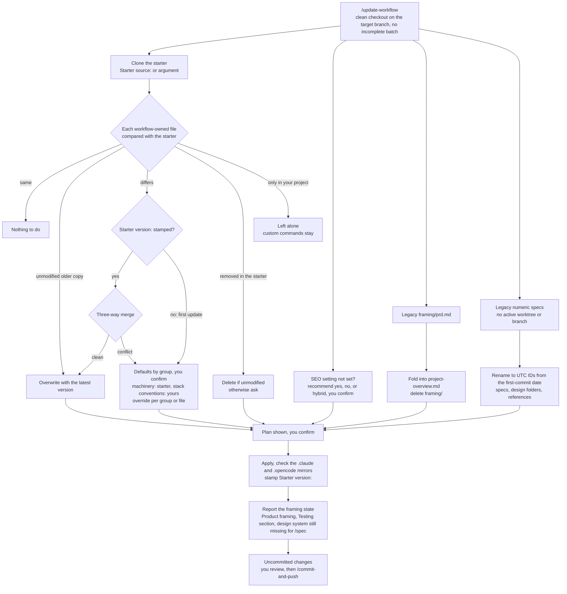

# Getting started

For a new project or an existing project that does not yet have `.context/`, run `/init-project` first. It inspects the existing codebase and initializes shared project context without choosing or bootstrapping a stack. Then run `/prd` followed by `/architecture`, run `/setup-stack` to apply the approved stack setup, run `/setup-backup` if the project has a database, and run `/design-system` if the project has a UI. `/architecture` alone is only the narrow documentation path when you want to record an existing project's architecture; it creates only `.context/architecture.md` and does not replace `/init-project` or unlock `/spec`.

The workflow does not require the GitHub CLI. Configure the project's `origin` remote and local target branch so the user-authorized `/commit-and-push` command can push after local review.

## Updating an already initialized project

Do not rerun `/init-project` when the shared project settings are already populated. Run `/update-workflow` instead, once per repository (a workspace folder holding several repositories is not a project: run it inside each one). It clones the starter named by `Starter source:` in `.context/project-settings.md`, or the git URL or local path you pass as its argument, and changes only what the starter owns:

| Class | Files | What the command does |
| --- | --- | --- |
| Workflow-owned | `.context/commands/`, `security-rules/`, `stacks/`, `coding-conventions/` (except `security.md`), `ai-workflow-*.md`; `.claude/` and `.opencode/` commands, agents, and hooks; `.githooks/` | Adds, updates, or deletes them |
| Merge-only | `.claude/settings.json`, `.gitignore`, `.gitattributes`, `AGENTS.md`, `CLAUDE.md`, `.context/project-settings.md` | Adds what the starter has and the project lacks, never removes local content (a framework-generated block in `AGENTS.md` survives) |
| Project-owned | overview, architecture, tracker, specs, ADRs, memory entries, `security.md`, README, changelog, `infra/`, code, and any custom command of yours | Never touched, except the spec renames below |

**First update versus later ones.** A project copied from an older starter has no `Starter version:` stamp, and its files often predate the starter's history, so the command cannot know which differences are your customizations. It never guesses a merge base: each differing file becomes a conflict, decided by group with one confirmation. Workflow machinery (commands, agents, hooks, `global.md`, `tdd.md`) defaults to the starter's version; stack convention files and recipes default to yours. You can flip a group or choose per file, and because the working tree must be clean, anything replaced is recoverable from Git. The command then stamps `Starter version:`, so later updates do a real three-way merge against it and only ask about true conflicts. If the project has no `project-settings.md` yet, the command asks for the target branch (default: the current one) and creates it; fill in `Test command:` and `Typecheck command:` afterwards.

**Spec migration.** Legacy `NNN-slug` specs get a UTC ID from the date of their first commit, kept strictly increasing in numeric order so specs committed together keep their original order. The rename covers the spec file, its design folder, and every reference in the Markdown files the update does not take from the starter, including application resources outside `.context/`. References inside accepted ADRs are retargeted too (only the reference text changes) and the plan lists those files. Specs with an active worktree or `feature/<spec-id>` branch keep their numeric ID until their handoff; run `/update-workflow` again afterwards. Mentions that cite only a spec number (for example "spec 006") are not rewritten, and old IDs remain in Git history.

**Legacy PRD.** A project framed with the earlier `.context/framing/prd.md` has that file folded into `project-overview.md` (Problem into the Overview if missing, perimeter into Scope, success criteria, constraints, reference product), then `framing/` is deleted. You confirm the merged result in the plan.

**SEO setting.** An older project has no `SEO:` value, so the command recommends one from what the project shows (`hybrid` when it has public pages and a logged-in area, with a drafted public scope), and you confirm or change it in the plan. An existing value is never overridden.

**After the update.** An older project usually lacks the product framing that `/spec` now requires, so the report lists the framing commands to run next (`/prd` when the overview lacks scope, success criteria or constraints, `/architecture` for the `## Testing` section, `/design-system` for UI projects). Obsolete leftovers outside the workflow's reach, such as the old `security-review-ecc` skill folder, are yours to delete. The command also removes the retired `Merge mode` and `Ship confirmation` settings and renames a legacy `OpenDesign URL:` key to `Design workspace URL:`, preserving its value. Existing pull requests or remote feature branches are not changed automatically; resolve any old pipeline work separately before switching to this local-review workflow. The command never commits or pushes.

**Expected effort.** Roughly 10 to 25 minutes per repository for a project with dozens of specs, most of it spent reading the plan and confirming the defaults (an estimate from a dry run, not a measurement). A project that is already stamped and has no legacy specs takes a few minutes.
