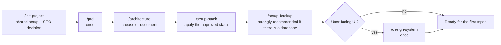
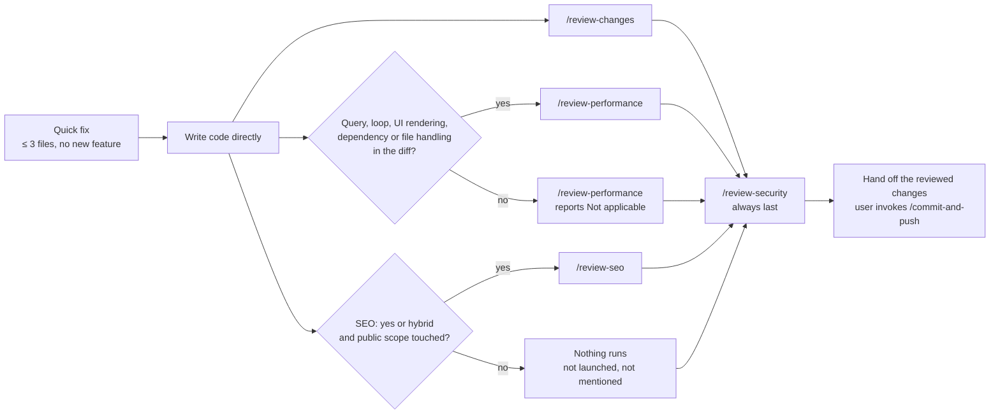
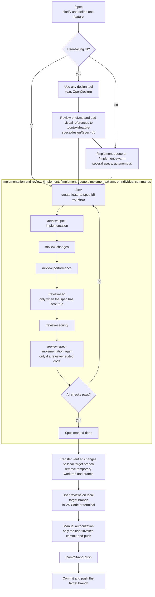
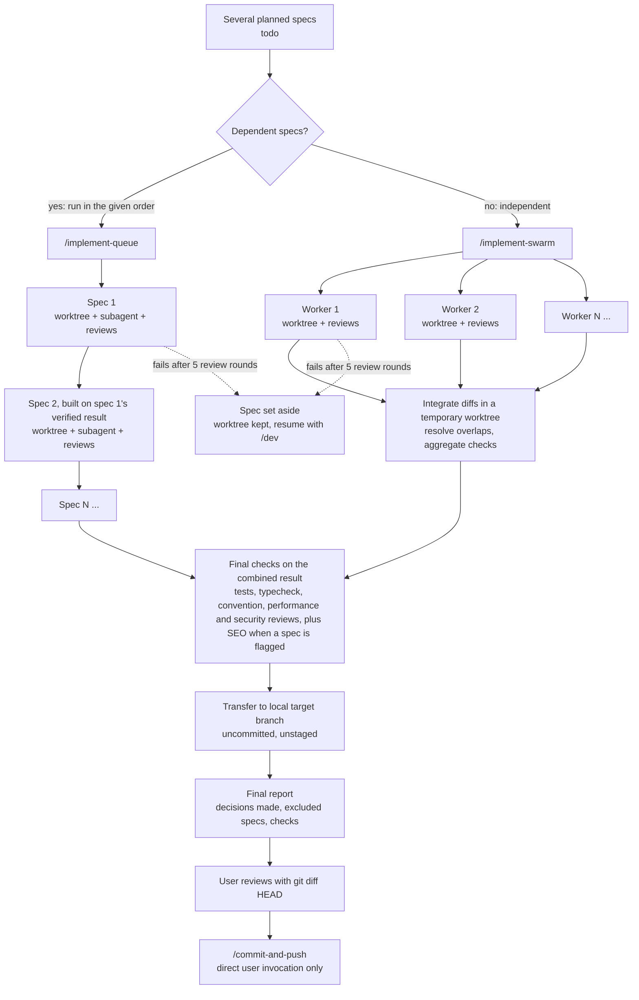

# AI Development workflow

Context and conventions live in `.context/` - start with `.context/ai-workflow-entrypoint.md` (also linked from `AGENTS.md`/`CLAUDE.md`).

The command names below use slash notation for readability. Claude Code and OpenCode both use slash commands (for example, `/spec`, `/implement`, and `/commit-and-push`) and follow the same canonical instructions in `.context/commands/`.

## Framing (once)

Run `/init-project` to populate shared project context and workflow settings without choosing a stack. It also settles the SEO question as one of three values stored in `.context/project-settings.md`: **yes** (the whole user-facing product is SEO-friendly), **no** (nothing is indexed), or **hybrid** (a public part is SEO-friendly and the rest, typically an authenticated dashboard, is not, with the public scope listed in `SEO public scope:`). `yes` and `hybrid` turn on `.context/coding-conventions/seo.md` and `/review-seo`, and `/spec` then flags each spec with `seo: true` or `false` so the review is launched, and mentioned, only for work that touches the SEO-relevant part; `html.md` applies to all markup either way. Then run `/prd` and `/architecture` manually, one at a time. For a new project, run `/setup-stack` to apply the approved stack-specific setup, then `/setup-backup` when the project has a database; run `/design-system` for UI projects once the UI stack and its tokens exist. `/spec` is blocked until shared initialization, the product framing, architecture, and (for UI projects) the design system are complete. Repeat framing later only if the documented product or architecture has drifted.



| Command | What it does |
| --- | --- |
| `/init-project` | Sets up shared project context and workflow settings, including whether the project is SEO-friendly (`yes`, `no`, or `hybrid` with a public scope); does not choose or bootstrap a stack |
| `/prd` | Frames the product: problem, perimeter, out-of-scope, success criteria, constraints - writes them into `.context/project-overview.md` |
| `/architecture` | Chooses and documents architecture for a new project (including hosting and domains, then pruning unused stack conventions), or documents the actual architecture of an existing codebase |
| `/setup-stack` | Applies the approved stack-specific setup (scaffold, infra, environment, verification) from the architecture decision and the matching recipe; asks before every outward-facing action, never commits, then offers to delete `.context/stacks/` |
| `/setup-backup` | Sets up the database backup to S3 for projects with a database, whatever the engine (PostgreSQL and MySQL/MariaDB out of the box, any other engine by adding its dump tool): webhook (API Platform operation or controller, per the architecture), dump and upload services, retention, failure email, a test; asks before outward-facing actions and never commits; strongly recommended when the project has a database |
| `/design-system` | UI projects only - locks design tokens, the brand identity (logo, favicon, share image) and a contrast audit into `.context/ui-context.md` |

## Day-to-day work: two paths

**Features** (the main path): once framing is done, the per-spec pipeline repeats for every feature:

```
/init-project → /prd → /architecture → /setup-stack (if needed) → /setup-backup (strongly recommended if there is a database) → /design-system (UI projects) → /spec
/spec → /implement                     (repeats, once per feature)
```

Use `/implement-queue <spec-id-or-file> <spec-id-or-file> [...]` when at least two already planned specs are ready and should run one after another (put dependencies first), or `/implement-swarm <spec-id-or-file> <spec-id-or-file> [...]` when they are independent and can run concurrently. Both run autonomously and never commit. You can pass exact IDs or drag and drop the `.md` spec files into any of these commands; their local `file:///...` URLs are resolved and checked against the current checkout. `/dev` and `/implement` accept the same file selectors, along with their existing name-fragment lookup.

**Quick fixes** (bugs, typos, small corrections - ≤ 3 files, no new feature): write code directly, no pipeline needed. Once the code is written, the agent runs `/review-changes` and `/review-performance`, plus `/review-seo` on SEO-flagged work, then `/review-security` last. `/review-performance` reports "Not applicable" on its own when the diff has no query or network call, loop, UI rendering, dependency change, or file handling, and `/review-seo` is launched only when the project is `SEO: yes` or `hybrid` (silent when the diff leaves the public scope). With `SEO: no` it is not launched or mentioned at all.



## Per-spec cycle

Each new spec uses a UTC ID in `yyyy_mm_dd_hh_ii_ss-spec-title` format (for example, `2026_09_27_15_42_31-add-search`). It gets its own temporary worktree, `.worktrees/<spec-id>/`, on a local branch `feature/<spec-id>` - one spec, one worktree, one branch, no PR. Existing numeric spec IDs remain supported. `/dev` creates the worktree and brings the spec and its design handoff into it; later commands resolve that worktree rather than assuming the session is already sitting inside it. Once implementation, spec verification, convention review, performance review, SEO review, and security review pass, the verified changes are transferred to the configured local target branch as uncommitted, unstaged changes. The worktree and feature branch are removed after the transfer is verified.



| Command | What it does |
| --- | --- |
| `/spec` | Explicitly classifies whether the feature has user-facing UI. UI specs may use any design tool (OpenDesign is one example) and include reviewed, versioned design references under `.context/feature-specs/design/`; non-UI specs skip design. The spec and handoff are shared across coding agents. |
| `/implement-queue` | Autonomous serial run: implements and reviews each selected spec in its own worktree on top of the previous verified result, then hands the combined uncommitted changes to the target branch with a decision report |
| `/implement-swarm` | Autonomous parallel run: implements and reviews multiple independent specs concurrently, integrates their diffs for local review, and records resumable cleanup state |
| `/implement` | Runs `/dev` → `/review-spec-implementation` → `/review-changes` → `/review-performance` → `/review-seo` (only for specs with `seo: true`) → `/review-security` in series, looping (up to 5 iterations) until everything checks out, and marks the spec done; the spec verifier runs again last whenever a reviewer edited code |

`/implement` is the recommended entry point for a feature - it's `/dev`, `/review-spec-implementation`, `/review-changes`, `/review-performance`, `/review-security`, and, for specs with `seo: true`, `/review-seo` wired together into one self-correcting loop. The reviewers fix in place, so when one of them edits code after the spec verification, the verifier runs again at the end of the iteration (in `/implement-queue` and `/implement-swarm` too, per spec and again on the integrated result); a failure there sends the loop back to `/dev`. It never commits or pushes: `/commit-and-push` is always a separate, manual step after `/implement` hands off. Each of the six stays available individually for a narrower job (e.g. running `/review-security` alone after a manual edit).

Specs live in `.context/feature-specs/` as Markdown files with `status: todo / in-progress / done`. New UI specs persist a design brief at `.context/feature-specs/design/<spec-id>/brief.md`; reviewed visual references and relevant assets live alongside it and travel with the spec worktree. The brief alone does not count as a reviewed visual reference; the user may explicitly approve a prose-only design. After review, the handoff places the changes on the local `Target branch` for manual inspection. `/commit-and-push` commits and pushes that target branch only after the user directly invokes it. Run `/status` at any point to see framing, design handoff, worktree, verification, and local-branch state.

After the user has reviewed and committed/pushed the local target-branch changes, the normal spec worktree is already gone and the target checkout is ready for the next spec. No second invocation or post-merge pull is needed. A queue or swarm batch normally removes the worktrees of every spec it transferred before handoff; if cleanup is interrupted, `/status` reports the manifest and `resume <batch-id>` on the command that started it (`/implement-queue` or `/implement-swarm`) safely resumes it before more implementation starts.

## Autonomous spec batches



`/implement-queue` and `/implement-swarm` are for unattended runs. Start one, walk away, and read the final report. Neither ever commits or pushes: the result lands uncommitted on the local target branch, and only your later `/commit-and-push` commits it. During the run they never ask you anything; ambiguities are decided by the agent following the spec, the conventions, and accepted ADRs, and every decision is listed in the final report with its reason and rejected alternative. A spec that fails after five review rounds is set aside (its worktree and branch are kept, `status: in-progress`, resumable with `/dev <spec-id>`) while the others continue. The shared rules are in `.context/commands/autonomous-mode.md`.

`/implement-queue <spec-id-or-file> <spec-id-or-file> [...]` runs the specs one after another in the given order. Each gets its own worktree, subagent, and review loop, and starts from the verified result of the previous spec, so later specs can depend on earlier ones. The combined result is checked once more and transferred at the end.

### Parallel batch (`/implement-swarm`)

`/implement-swarm <spec-id-or-file> <spec-id-or-file> [...]` starts one implementation worker per selected `todo` spec. You can drag and drop spec files such as `file:///D:/Projects/my-app/.context/feature-specs/006-dashboard-stats.md`; the shared resolver confirms each file belongs to this checkout and derives its exact spec ID. Each worker uses its own `.worktrees/<spec-id>/` and `feature/<spec-id>` branch. The primary agent waits for every worker, runs the spec, convention, performance, and security reviews (plus SEO for specs with `seo: true`), combines their uncommitted changes in an isolated integration worktree, resolves overlaps, runs aggregate checks, and transfers the complete result to the local target branch as uncommitted, unstaged changes.

No feature worker creates commits, so this is patch-based three-way integration rather than `git merge --no-commit`. The ignored `.worktrees/.parallel-batches/<batch-id>/manifest.json` records each phase and cleanup operation. If execution is interrupted, `/status` reports the batch and its remaining worktrees; resume with `/implement-swarm resume <batch-id>` (or `/implement-queue resume <batch-id>` for a queue). The command never deletes a worktree until the full transfer to the target checkout is verified. New specs and batches wait until an incomplete batch is recovered and the target-branch changes have been reviewed and committed by the user.
